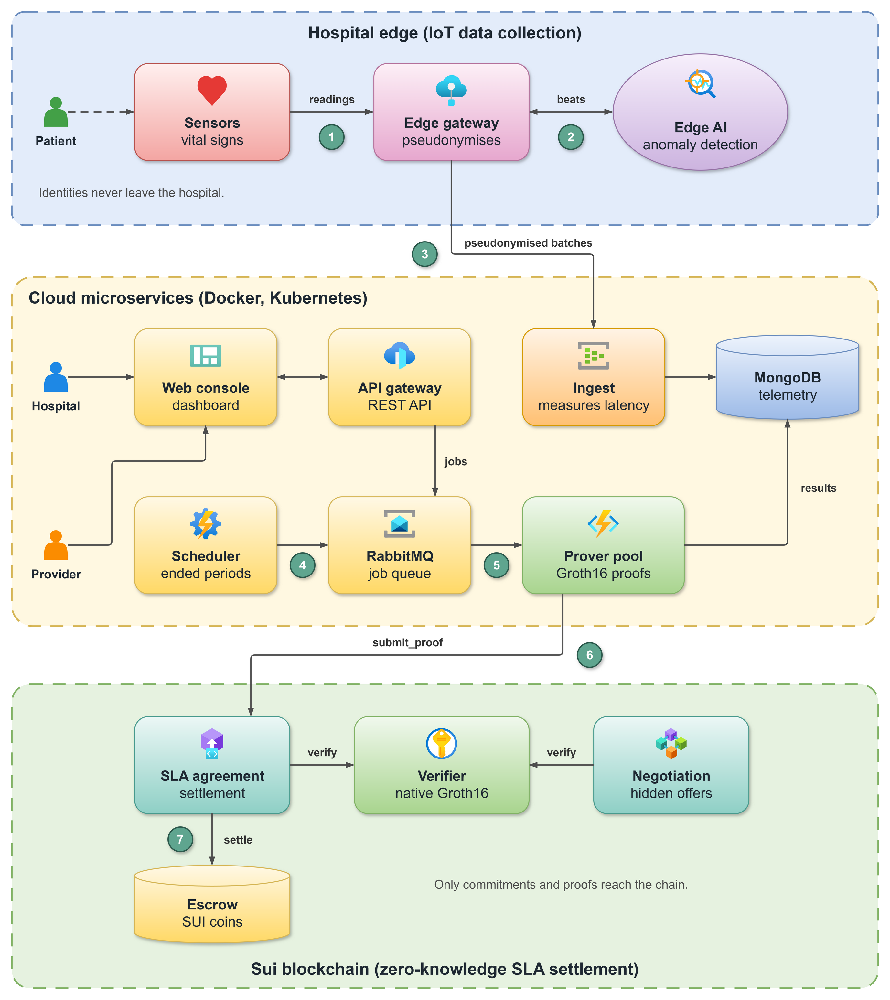
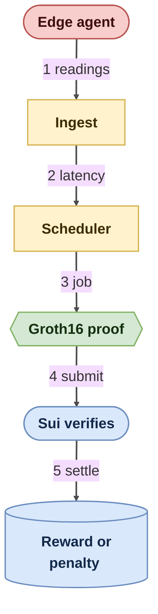

# services

These are the dockerised microservices of the Shaker Genopole ZK-SLA platform. Edge gateways stream pseudonymised IoT telemetry. A pool of prover workers turns each SLA period into a Groth16 (BLS12-381) proof, which settles on Sui without revealing devices, locations or raw readings.

| Repository                                                          | Role                                                                            |
| ------------------------------------------------------------------- | ------------------------------------------------------------------------------- |
| [contracts](https://github.com/Shaker-Genopole/contracts)           | Sui Move package: verifier registry, SLA escrow, ZK negotiation                 |
| [zk-circuits](https://github.com/Shaker-Genopole/zk-circuits)       | Circuits, trusted-setup artifacts, prover and Sui encoders (`@zk-sla/circuits`) |
| **services**                                                        | Microservices (this repository)                                                 |
| [infrastructure](https://github.com/Shaker-Genopole/infrastructure) | Full-stack compose from published images, Kubernetes manifests, Terraform       |
| [fontend](https://github.com/Shaker-Genopole/fontend)               | Web console                                                                     |

## Architecture

<p align="center">
  <a href="docs/architecture.pdf"></a>
</p>

_Figure 1. Platform architecture ([PDF](docs/architecture.pdf), source [docs/architecture.drawio](docs/architecture.drawio)). The numbered steps trace one SLA period from sensor to settlement. Icons: Microsoft Azure architecture icons and draw.io basic shapes._

1. Sensors stream vital signs to the edge gateway.
2. The edge AI classifies ECG beats locally and flags anomalies.
3. Pseudonymised batches reach the telemetry ingest, which measures sensor-to-cloud latency.
4. The scheduler queues every SLA period that has ended.
5. A prover worker checks the period and produces a Groth16 proof (BLS12-381).
6. The proof is submitted to Sui and verified natively by `sui::groth16`.
7. The agreement releases the reward, or the consumer claims the penalty after the grace window.

### Proof pipeline



| Service            | Responsibility                                                                                                                                                | Scales by                                       |
| ------------------ | ------------------------------------------------------------------------------------------------------------------------------------------------------------- | ----------------------------------------------- |
| `api-gateway`      | Auth (JWT), agreements, sealed deployment registration, negotiation, proof ledger, evaluation KPIs, `/metrics`                                                | replicas behind a load balancer                 |
| `telemetry-ingest` | Authenticates edge nodes, rejects raw identifiers, measures sensor-to-cloud latency, writes a MongoDB time-series collection, forwards edge alerts            | replicas (stateless)                            |
| `edge-agent`       | Simulated edge gateway replaying Kaggle-shaped data: int8 ECG beat classifier, vital-sign rules, battery-aware sampling, store-and-forward uplink             | one per gateway                                 |
| `scheduler`        | Detects finished SLA periods and enqueues proofs exactly once (idempotent claim), re-queues stale jobs, marks lapsed periods                                  | replicas (idempotent)                           |
| `prover-worker`    | Aggregates period telemetry, opens the sealed deployment, checks the SLA, builds the witness, proves and verifies Groth16, and submits to Sui when configured | **horizontal**: `--scale prover-worker=N` / HPA |
| `taskmanager`      | Persists results (proof ledger, period state, negotiation candidates), worker heartbeats and alerts                                                           | replicas                                        |
| `chain-indexer`    | Follows `zk_sla` events over gRPC and projects them onto the off-chain mirror                                                                                 | single                                          |

Packages: `shared-configs` (env schemas, queue and collection names), `shared-connections` (MongoDB, RabbitMQ with dead-lettering, schema bootstrap), `shared-entities` (domain types), `shared-utils` (logging, AES-256-GCM sealing, HMAC pseudonyms, statistics), `datasets` (Kaggle adapters and synthetic generators), and `sui-client` (gRPC transactions and events).

### Privacy boundaries

- Edge agents send `deviceRef = HMAC(PSEUDONYM_KEY, deviceId)` only. Ingest rejects anything that is not a 32-hex pseudonym.
- The deployment (device IDs, locations, sensor configuration, salt) is sealed with AES-256-GCM. Only its Poseidon commitment is published, and only prover workers hold `SEAL_KEY`.
- Offer figures for negotiation are sealed the same way. Consumers see a label and a commitment.

## Datasets (Kaggle)

| Dataset                                                                                                                        | Used for                                                                                                  | License          |
| ------------------------------------------------------------------------------------------------------------------------------ | --------------------------------------------------------------------------------------------------------- | ---------------- |
| [ziya07/healthcare-iot-data](https://www.kaggle.com/datasets/ziya07/healthcare-iot-data) (`healthcare_iot_target_dataset.csv`) | Wearable vitals (temperature, blood pressure, heart rate) and device battery, replayed by edge agents     | CC0              |
| [shayanfazeli/heartbeat](https://www.kaggle.com/datasets/shayanfazeli/heartbeat) (`mitbih_train.csv`)                          | MIT-BIH ECG beats (187 samples at 125 Hz, classes N/S/V/F/Q) for training the edge classifier             | see dataset page |
| [colabsss/green-iot-edge-resource-dataset](https://www.kaggle.com/datasets/colabsss/green-iot-edge-resource-dataset)           | Edge-node latency, resources and QoS, aggregated into per-node capability profiles for negotiation offers | CC0              |

```bash
pnpm datasets:fetch   # needs the Kaggle CLI and credentials; writes ./data
```

Without the CSVs, every service falls back to deterministic synthetic data with the same schema and value ranges ([packages/datasets/src/synthetic.ts](packages/datasets/src/synthetic.ts)).

## Running

```bash
cp .env.example .env                      # replace secrets outside local dev
docker compose up --build                 # core stack: gateway :8080, ingest :8081, RabbitMQ UI :15672
docker compose --profile demo up --build  # + seed SLA/offer/request and two edge gateways streaming telemetry
docker compose up --scale prover-worker=4 # scale the proving pool
```

The demo SLA uses 2-minute periods. After the first period ends, the scheduler queues a proof and a worker proves it. `GET /api/kpis` then reports proof generation and verification time, proof size, SLA compliance rate, telemetry latency and gas.

### On-chain mode

1. Deploy [contracts](https://github.com/Shaker-Genopole/contracts) with `scripts/deploy.sh`.
2. Set `SUI_PACKAGE_ID`, `SUI_VERIFIER_REGISTRY_ID`, `SUI_GRPC_URL` and the provider's `SUI_PRIVATE_KEY`.
3. Create the agreement on chain and pass its object ID as `onChainId`.

Workers then call `zk_sla::sla::submit_proof` and record the transaction digest and gas. Start `chain-indexer` with `--profile chain` to mirror the chain events.

## Development

```bash
pnpm install
pnpm build
pnpm test    # unit tests + real Groth16 proving + gateway/prover integration on in-memory MongoDB
```

The first `pnpm test` downloads a MongoDB binary for the integration test.

## License

MIT
